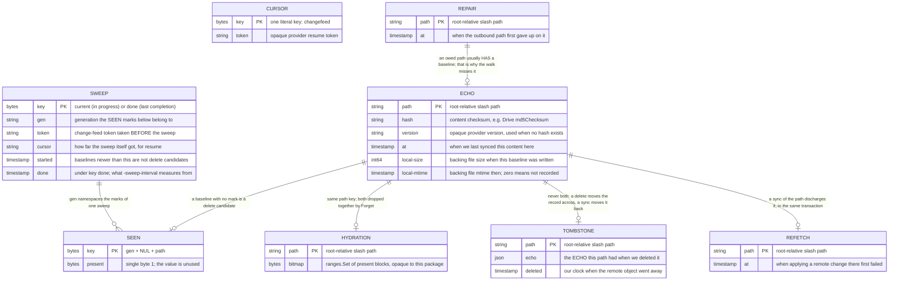
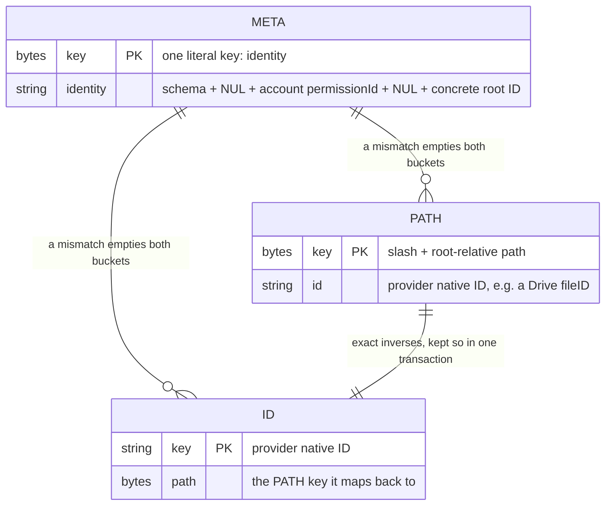
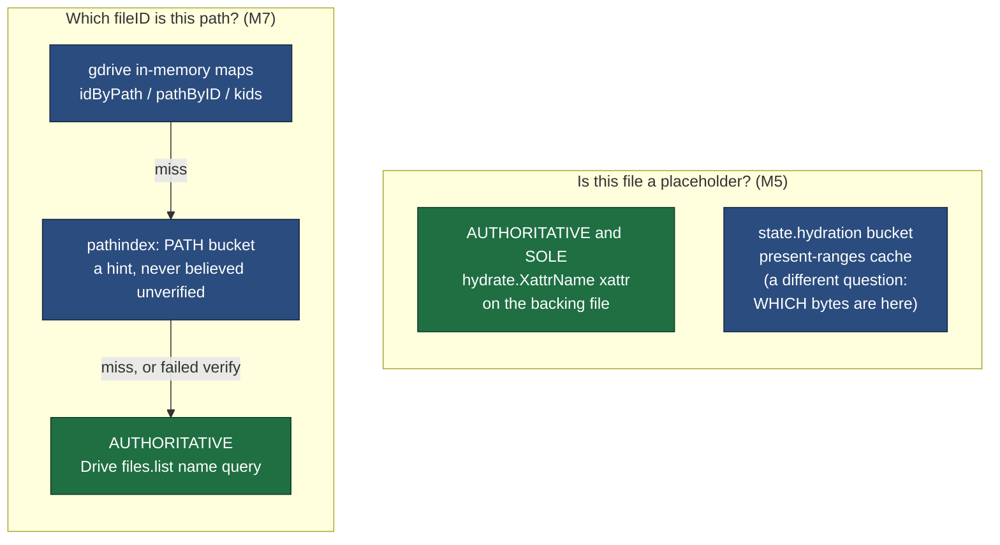

# Storage schema

Drivel keeps two embedded [bbolt](https://github.com/etcd-io/bbolt) databases.
They are two files on purpose, split along the provider seam (DESIGN.md §2.4,
§2.5): the engine-level one is provider-agnostic, and the other holds a single
provider's private path↔ID translation for a single account. Merging them would
put per-account, wipe-on-mismatch data inside the sync engine's reach.

Neither file is authoritative for anything. Losing either costs latency, API
quota and precision — never user data. The [authority ladder](#authority-ladder)
below is the reason.

Since M8 there is one pair of these files **per mount**, not per process: a
configured mount defaults its state DB to `$XDG_STATE_HOME/drivel/<name>/state.db`.
The schema below is unchanged — what changed is that sharing one between two
mounts is now a startup error rather than a slow surprise, because each engine
would read the other's echo records as its own baseline.

## `drivel-state.db` — engine sync state

Owned by `internal/state`. Written by the uploader, the downloader and the M7b
reconciler; bbolt serialises the writers and gives readers a snapshot, so there
is no extra locking.

What each bucket costs if the file is lost:

| bucket | role | loss |
| --- | --- | --- |
| `cursor` | where to resume the change feed | fresh token, then a full sweep |
| `echo` | §4 loop breaker **and** the M7b delete baseline | first-run semantics: deletes nothing, re-pushes |
| `hydration` | M5 present-ranges cache over the xattr marker | one stat |
| `sweep` | resume point of an interrupted enumeration, plus when the last one finished | the sweep restarts, and the next mount treats a periodic sweep as overdue |
| `seen` | which paths one sweep observed remotely | a resumed sweep would infer false deletes — which is why these are on disk and not in memory |
| `repair` | paths the uploader gave up on, for the next sweep to re-send (M27) | those files wait for `-sweep-interval` again, and are not repaired at all if it is `0` — though a lost push is still found by the walk's fingerprint row, which needs no record |
| `refetch` | paths whose inbound apply failed while the cursor moved past them, for the pull loop to fetch again | those changes wait for the next sweep, and are not retried at all at `-sweep-interval 0` until something else touches the path — which is how every failed download behaved before this bucket existed (MC-46) |
| `tombstone` | the baseline a deletion dropped, so a provider still serving its pre-deletion view is recognised rather than applied (§4.5) | a file deleted within the last few minutes can come back, and the directory it was in comes back permanently |

`local-size` / `local-mtime` fingerprint the **backing** file, not the remote one,
and they exist for providers that publish no content checksum — every filesystem
backend in the M17–M21 group, where `hash` is always empty. They are what M7b's
`matchesBaseline` uses to tell "unmodified since we last agreed with the remote"
from "edited locally", which is the question deciding whether a remote deletion is
applied here or the local file is kept and pushed back.

**Since M27 part 4 the sweep's local walk reads them too, for the opposite
action**: a path whose fingerprint no longer matches is a push that was *lost*
rather than abandoned (a crash, a power cut, an OOM kill, a drain that timed out,
a backing file written while the mount was down), and it is re-sent. The two
readings share one comparison (`fingerprintDiverged`) on purpose — a delete row
and a push row disagreeing about whether a file changed is a bug waiting to be
written — and they differ only in what "not recorded" does: the delete row keeps
the file, the push row declines to send it. So **a hashless provider's fingerprint
is now load-bearing in both directions**, and anything that stops recording it
(or records it before a push rather than after) silently disables a repair as well
as a deletion.

Size and mtime are weaker than a digest and sufficient for this one job, because
this is the *local* file: the kernel keeps its mtime to nanoseconds, so any write
moves it. The remote's own coarse mtime never enters into it.

**A zero `local-mtime` means "not recorded", never "matches".** That covers an
echo written before the fields existed, a directory, and a stat that failed.
Reading it as a match would delete a file somebody had edited. Before these fields
existed a hashless provider answered "no baseline to compare against" for every
file, so a deletion made on the remote was undone on the very next sweep — found
against a live OpenSSH server, not in a test.

`repair` and `refetch` are the two buckets written by a *failure* path, one per
direction, and both are deliberately not queues: each holds a path and a time,
never an operation and never content. For `repair` the sweep re-derives what to
send from the backing file as it stands when it gets there, which is the only honest answer once an arbitrary amount of time has
passed — and it is what keeps this from becoming the persistent outbound queue
DESIGN.md §9/M27 declines to build, with a second durability surface over the one
§12 already prices.

Two things about it are load-bearing. `OweRepair` **compares before writing**, so
re-recording a path already owed costs no commit: the shape that abandons the
most pushes is a non-retryable error, which gives up after one attempt with no
backoff, so a permission failure over a large tree would otherwise fsync twice
per file per retry round. And the sweep **clears a record before re-pushing it,
never after** — `Push` is synchronous and records a fresh debt of its own if it
gives up again, so clearing afterwards would erase the one thing saying the file
is still unsent.

`refetch` exists because the pull loop **cannot hold its cursor for one change**:
a change that can never apply (a full disk, a name the backing filesystem
refuses) would then stop inbound sync for every other path, for good. So the
cursor advances, and the path is recorded instead. The retry is far cheaper than
M27's, and so needs no sweep: one `Stat` of the path and the feed's own apply of
whatever the remote holds *then* — never a replay of the change that failed. A
failed **removal** is not recorded, for the reason M27 declines an abandoned
deletion: re-applying it later deletes whatever is at the path by then. Like
`repair` it compares before writing; unlike `repair` it is usually discharged for
free — `SetEcho`, `ForgetMany` and `ForgetDeleted` each drop it in the
transaction they already commit, so a retry that downloads costs one commit, the
same as the download would have.

`tombstone` is the `echo` bucket's other half rather than a bucket in its own
right: a deletion moves the record across in one transaction (`ForgetDeleted`),
and a later sync of that path moves it back (`SetEcho` drops any tombstone, same
transaction, no extra commit). So a path has at most one of the two, and the
delete push still costs the single commit it cost before this existed.

It is a *separate* bucket for the reason the echo is read in four places — M7b's
delete baseline, M6's gate 2, the sweep's "new locally" row, M27's lost-push row
— and a tombstone must be invisible to every one of them. A flag on the `echo`
record would have been invisible only for as long as nobody forgot to check it.

What reads it is the inbound path, and only for a path with no live baseline: a
report carrying the content the deletion removed, inside `tombstoneWindow`
(5 minutes), is this mount's own delete coming back and is dropped. The test is
**identity and not time** — our deletion stamp is this machine's clock and the
report's timestamp is the provider's, so comparing them is wrong by the skew
between two clocks, in the direction that decides whether somebody's file comes
back. The sweep prunes expired records, which is the only thing that bounds the
bucket; a mount that never completes a sweep keeps one record per deleted path,
of a size with the baseline that path already had.

**A move re-keys four of these buckets and deliberately not the other two.**
`state.RenameSubtree` carries `echo`, `hydration`, `repair` and `refetch` from the old path
and everything beneath it to the new one, in a single transaction whatever the
subtree's size — they all answer "what do we know about the object at this path",
so they follow the object. `tombstone` stays where it is: it records the deletion
of whatever *used* to be at a path, and the object arriving there is a different
one, so carrying it across would arm a five-minute suppression against content
nobody deleted. `seen` stays too — its marks are per sweep generation, and the
feed is not applied while a sweep is running (snapshot-then-tail), so no live
generation can be describing the tree a move is changing.

Both directions call it, and the reason is the same on each: nothing else tells
that side where the subtree went. Inbound it is a provider reporting
`RemoteChange.MovedFrom`; outbound it is the engine's own `Move`. Dropping the
records instead — which is what a rename did before, for the renamed path only
and never for its descendants — makes every descendant's baseline name a path
that no longer exists, which is indistinguishable from a remote that has lost
them: MC-27 measured it as 1100 re-downloads and 1101 proposed deletions, over a
`-max-deletes` of 100, so the pass that was meant to repair the rename refuses
itself and the subtree stays doubled.

The `echo` bucket is the one that grows: a baseline is dropped when the path is
gone on **both** sides, and only a sweep can establish that. Deletes seen while
running are pruned on the path that caused them — through the mount by
`Engine.forgetPath`, through the feed by the page-batched `flushForget`. What is
left over is offline activity and the failure tail, which the periodic sweep
(`-sweep-interval`, default 24h) exists to clear.

Do not prune it any other way. Pruning a baseline and inferring a delete are the
same decision from the same evidence: "absent locally" cannot distinguish *already
gone on both sides* from *deleted locally while we were down, remote still has
it*, and dropping the second loses a pending delete — the next sweep then finds a
remote file with no baseline and puts it back. TTL and LRU eviction fail the same
way, silently, since neither age nor recency says anything about whether the path
still exists.

## `drivel-index.db` — provider path↔ID index

Owned by `internal/pathindex`, composed privately by `gdrive`. Below the seam:
the sync engine never sees it and never learns what a native ID is.

Three properties that are load-bearing rather than incidental:

- **Keys carry a leading slash.** bbolt rejects a zero-length key and the mount
  root is the empty path. It also makes the subtree prefix uniform (`"/a/"`),
  and `/` sorts below every character a path component can start with, so a
  directory's children are one contiguous run — `Forget` and `Rename` are a seek
  plus a walk, not a full-bucket scan.
- **The two directions are written in one transaction**, evicting both stale
  halves (the ID this path used to name, the path this ID used to live at). A
  leftover reverse entry resolves a change-feed ID to a path it no longer
  occupies, and `Files.Update` on that destroys data with no conflict copy.
- **`meta.identity` binds the file to one account and one root.** Binding is
  lazy — at first index use, not at open — because mount must not require the
  network. Unbound reads empty and drops writes.

## Authority ladder

Everything in both databases is derived. This is what the sync engine actually
trusts, cheapest source first, with only the bottom row authoritative:

The M5 ladder has one rung, and that is the correction M10 made rather than a
simplification of the diagram. `Hydrator.IsPlaceholder` reads the marker and
nothing else: the hydration bucket caches *present ranges*, which answers "which
bytes are here", and no code path has ever consulted it to answer "is this a
placeholder". So there is no fallback — a backing filesystem that cannot store the
attribute has no placeholder record at all, immediately, and `-lazy` is unsafe
there rather than merely fragile. The attribute's spelling is per platform
(`user.drivel.placeholder` on Linux and macOS, `drivel.placeholder` in
`EXTATTR_NAMESPACE_USER` on FreeBSD), so callers use `hydrate.XattrName`.

The M7 rule is the one that is easy to erode: a persisted entry is a hint about
the past. The process that wrote it may have exited months ago, and the remote
is free to have moved, renamed, replaced or trashed that object since — the ID
still resolves, just to the wrong file. `verifyLocked` re-checks name, parent and
not-trashed before an entry is believed, and a failed directory drops its whole
subtree. That check is the price of persistence, not an optimisation to remove.

## Durability, and what losing either file costs

Both files are written with bbolt's default durability: every write transaction
fdatasyncs twice, once for the data pages and once for the meta page that makes
them reachable. Nothing is buffered, and no write is acknowledged before it is on
disk.

That is a deliberate position rather than a default nobody looked at, because it
is not free. A commit rewrites every page it touched — measured at **~36 KB on a
10 000-entry DB regardless of how small the record is, and flat as the DB grows** —
so disk cost is *commits × a constant*, and the fsyncs are essentially all of it
(opening with `NoSync` and syncing after every commit reproduces the same total;
removing the syncs leaves 1.5% of the bytes). `DESIGN.md §12` has the measurements,
the reason group commit is not used, and what would have to be true to change that.

The practical rule for anyone adding a store write: **count the commits on a
per-file path.** `state.Store.Commits` and `pathindex.Store.Commits` report them,
and `TestPushCommitsPerFile` in `internal/syncengine` pins the budget at one
commit per pushed file. Redundant index writes were removed by comparing before
writing, in a read transaction — bbolt advances the meta page on every commit
whether a data page changed or not, so re-storing a byte-identical value costs a
full commit while a `View` costs nothing. Re-pushing a file went from three
commits to one; creating a new one still costs two, because its path↔ID mapping
genuinely is new.

**Losing either file is recoverable, and the two are recoverable for different
reasons.**

| | what is lost | what happens next | what it costs |
|---|---|---|---|
| `drivel-index.db` | path↔fileID hints | an unknown path falls through to a `files.list` name query, which is the authority anyway | latency and API quota |
| `drivel-state.db` | cursor, §4 echoes and tombstones, hydration bitmaps, sweep marks | no cursor means the downloader enumerates the whole tree before tailing it | a full re-sync's requests, and a §6 conflict copy per genuinely divergent path |
| either, unreadable | as above | the file is renamed `.corrupt` and an empty one takes its place | as above, plus a line in the log |

Neither loses data, and the state DB's case rests on a specific rule: M7b infers a
deletion **only** from a baseline, so a store with no echoes reads every path as
new on whichever side it is found and deletes nothing — the first-ever-run rule.
M5's placeholder marker is an xattr on the backing file, not a row here, so no
placeholder turns into an empty file either.

Because of that, **a database bbolt cannot read is moved aside and replaced** —
renamed with a `.corrupt` suffix, only the most recent one kept. For the state DB
that replaces failing the mount, which protected nothing (the file is already
unreadable) and left an unattended fstab mount with nobody to delete it by hand;
the mount logs it loudly, because the re-enumeration and conflict copies that
follow are visible and would otherwise look like a bug. For the index it replaces
running from memory, which was correct but permanent for the life of the process,
so one bad write cost every later session a cold index; that one logs briefly,
because nothing follows but name lookups.

A file that fails to open for any *other* reason is unchanged — fatal for state,
run-from-memory for the index. In particular **a lock held by another process is
never treated as corruption**, since replacing that file would pull the database
out from under a running mount.
